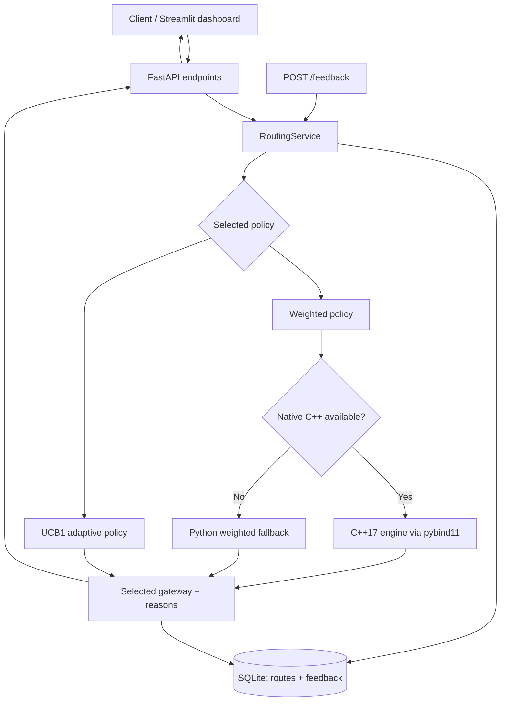

# RouteWise — Intelligent Payment Routing System

RouteWise is an educational simulation of a payment gateway orchestration service. It compares three simulated gateways and selects one based on expected success rate, latency, and a relative cost index. It includes two routing strategies:

- **Weighted routing:** deterministic ranking of healthy gateways using configurable success, latency, and cost weights.
- **UCB routing:** Upper Confidence Bound (UCB1) selection that uses recorded simulated outcomes to trade off observed success rate and exploration.

The API records each routing decision and simulated feedback in SQLite. The dashboard lets you submit route requests, record outcomes, and inspect recent routing statistics. The weighted engine is implemented in C++17 and exposed through pybind11; a matching Python fallback keeps the project usable before the native extension is compiled.

> **Simulation only:** RouteWise does not connect to real payment processors, authorize transactions, move money, or use actual gateway credentials. Gateway costs are fictional relative units, not fees or currency amounts. The configured and simulated success rates are examples, not service guarantees.

## Key features

- C++17 weighted gateway ranking, with Python fallback.
- Python UCB1 adaptive policy based on recorded outcomes.
- FastAPI REST endpoints with Pydantic validation.
- SQLite persistence, unique transaction IDs, and idempotent route requests.
- Feedback endpoint to record simulated success/failure and observed latency.
- Explainable route results showing scores and gateway metrics.
- Streamlit dashboard.
- Reproducible synthetic traffic and routing-policy comparison.
- Concurrent API load-test script reporting throughput and p50/p95/p99 latency.
- Pytest unit and API integration tests, plus GitHub Actions workflow.

## Architecture



## Repository structure

```text
RouteWise/
├── routewise/
│   ├── api.py             # FastAPI application and endpoints
│   ├── adaptive.py        # UCB1 ranking based on persisted feedback
│   ├── config.py          # Settings and gateway JSON loading
│   ├── database.py        # SQLite schema, transactions, read helpers
│   ├── main.py            # Uvicorn entry point
│   ├── router.py          # C++ extension wrapper and Python fallback
│   ├── schemas.py         # Pydantic request/response models
│   └── service.py         # Routing, idempotency and feedback business logic
├── cpp/
│   ├── router_engine.hpp  # Native-engine data structures and declarations
│   ├── router_engine.cpp  # Weighted scoring implementation
│   └── bindings.cpp       # pybind11 bridge
├── config/gateways.json   # Example gateway characteristics and weights
├── dashboard/app.py      # Streamlit dashboard
├── scripts/
│   ├── compare_policies.py
│   ├── load_test.py
│   └── simulate_traffic.py
├── tests/                 # Unit and HTTP integration tests
├── docs/                  # Architecture, learning guide, interview guide
├── data/                  # Runtime SQLite database (ignored by Git)
├── benchmarks/             # Generated comparison outputs (ignored by Git)
├── CMakeLists.txt
├── requirements.txt
└── README.md
```

## Requirements

- Python 3.10+ (Python 3.11 recommended).
- Git (optional, for source control).
- CMake 3.18+ and a C++17 compiler to build the native extension. On Windows, Visual Studio Build Tools with the C++ workload is one option; on Linux, install `build-essential`; on macOS, install Xcode Command Line Tools.
- Internet access for installing Python dependencies.

The API and tests can run using the Python fallback if the native C++ extension cannot be built. To verify actual native integration, build the extension and confirm that `/health` reports `native_cpp_available: true`.

## Quick start — Windows PowerShell

From the extracted repository folder:

```powershell
py --version
py -3.11 -m venv .venv
.\.venv\Scripts\Activate.ps1
python -m pip install --upgrade pip
pip install -r requirements.txt
python -m pytest -q
uvicorn routewise.main:app --reload
```

If PowerShell refuses to activate the environment, use this temporary setting in the current terminal only, then activate again:

```powershell
Set-ExecutionPolicy -Scope Process Bypass
.\.venv\Scripts\Activate.ps1
```

Open `http://127.0.0.1:8000/docs` to explore the API. The first run creates `data/routewise.db` automatically.

### Linux / macOS

```bash
python3 -m venv .venv
source .venv/bin/activate
python -m pip install --upgrade pip
pip install -r requirements.txt
python -m pytest -q
uvicorn routewise.main:app --reload
```

## Build the C++17 / pybind11 extension

First ensure that CMake and a working C++17 compiler are installed. The `pybind11` Python package is included in `requirements.txt`.

### Windows PowerShell

```powershell
python -m pybind11 --cmakedir
cmake -S . -B build -Dpybind11_DIR="$(python -m pybind11 --cmakedir)"
cmake --build build --config Release
python -c "import routewise_cpp; print(routewise_cpp.__doc__)"
```

### Linux / macOS

```bash
cmake -S . -B build -Dpybind11_DIR="$(python -m pybind11 --cmakedir)"
cmake --build build --config Release
python -c "import routewise_cpp; print(routewise_cpp.__doc__)"
```

The build places the native module in the repository root so Python can import `routewise_cpp`. The extension is optional for fallback-mode use but required to claim the native engine is active. Confirm with:

```bash
python -c "from routewise.router import native_cpp_available; print(native_cpp_available())"
```

Expected after a successful build: `True`.

## Try the API

### 1. Health

`GET http://127.0.0.1:8000/health`

Example response (the native flag depends on your build):

```json
{
  "status": "ok",
  "native_cpp_available": false,
  "database": "sqlite"
}
```

### 2. Route a transaction

`POST http://127.0.0.1:8000/route`

```json
{
  "transaction_id": "txn-demo-001",
  "amount": 1850.00,
  "currency": "INR",
  "policy": "weighted"
}
```

The API chooses the highest-scoring healthy gateway under the current configuration. Its response includes the selected gateway, a routing score, baseline characteristics, reasons, and creation time. The figures are simulated.

### 3. Record feedback

Only submit feedback after a route has been selected:

`POST http://127.0.0.1:8000/feedback`

```json
{
  "transaction_id": "txn-demo-001",
  "success": true,
  "actual_latency_ms": 142.5
}
```

This represents a simulated outcome. For `ucb` requests, UCB1 can use the feedback to inform later selection. Each transaction can have one feedback record; an exact retry is idempotent, but a contradictory second outcome is rejected.

### 4. Other endpoints

- `GET /gateways` — configured gateway metrics and observed feedback summaries.
- `GET /transactions/{transaction_id}` — retrieve a routing decision.
- `GET /routes?limit=20` — list recent decisions.
- `GET /stats` — route counts and observed feedback statistics.
- `GET /docs` — Swagger UI.

## Run the dashboard

Keep the API running in the first terminal. In a second terminal, activate the virtual environment and execute:

```powershell
streamlit run dashboard/app.py
```

On Linux/macOS, the command is the same after activating `.venv`. Streamlit prints a local URL, usually `http://localhost:8501`.

## Simulate traffic and compare policies

With the API running, send 100 simulated routes and feedback outcomes:

```bash
python scripts/simulate_traffic.py --count 100 --policy ucb --seed 42
```

Compare weighted, round-robin and UCB1 strategies offline:

```bash
python scripts/compare_policies.py --count 5000 --seed 42
```

The comparison writes `benchmarks/policy_comparison.csv`. This is a reproducible synthetic simulation, not an empirical claim about real payment gateways.

Run an HTTP load test against the running API:

```bash
python scripts/load_test.py --requests 500 --concurrency 20
```

The script prints succeeded/failed requests, throughput, mean latency, and p50/p95/p99 latency. Run multiple trials on an otherwise idle machine and record the environment with the numbers. Do not mix first-startup effects with steady-state measurements.

## Run all tests

```bash
python -m pytest -q
```

The tests cover weighted ranking, healthy-gateway filtering, UCB exploration, API validation, route persistence, idempotency, feedback conflicts, stats, and simulation reproducibility. Tests do not require the native extension; if the extension is present, the weighted-ranking wrapper calls it.

## Configuration

Edit `config/gateways.json` to change the example gateway characteristics and default routing weights. Environment variables can override the weights and storage paths. See `.env.example` for the variable names. The project does not automatically load `.env`; either export the variables in your shell or configure the environment in your IDE.

Weights are normalized before use, so their ratios matter more than their total. `latency_reference_ms` and `cost_reference_units` control normalization. Adjust them thoughtfully and test how rankings change.

## How the algorithms work

### Weighted policy

Each healthy gateway receives a score:

`score = w_success * success_rate + w_latency * latency_score + w_cost * cost_score`

Where:

- `latency_score = max(0, 1 - latency_ms / latency_reference_ms)`
- `cost_score = max(0, 1 - cost_units / cost_reference_units)`
- Weights are non-negative and normalized to sum to one.

The highest score wins; ties are resolved using the gateway ID for deterministic behavior. This approach is predictable and easy to explain, but it depends on chosen weights and supplied metrics.

### UCB1 adaptive policy

UCB1 treats a simulated gateway as an arm and the outcome success/failure as reward 1/0. Until every healthy gateway has at least one feedback sample, it selects an untried gateway for exploration. Once all have data, its score is:

`UCB = observed_success_rate + sqrt(2 * ln(total_feedback_count) / gateway_feedback_count)`

The exploration term can temporarily favor a gateway with fewer observations, even if its current observed success rate is lower. UCB is a simplified educational bandit policy; it does not incorporate all risk, latency, cost, traffic-segment or non-stationarity concerns needed for a production payment router.

## Data and safety notes

- Gateway metrics and simulation outcomes are fictional.
- Do not include card numbers, CVVs, bank credentials, tokens, or other sensitive payment data.
- This code selects simulated routes only; it does not contact gateways.
- SQLite's single-writer behavior is suitable for a student demo, not a high-throughput production service.
- There is no authentication or authorization. Keep the service bound to localhost for local work; do not deploy this demo publicly as-is.
- Persisted UCB feedback can be misleading if outcomes are biased, too sparse, or change over time.
- The weighted score is a ranking utility, not a calibrated probability of payment success.

## GitHub setup

```bash
git init
git add .
git commit -m "Build RouteWise routing simulator"
git branch -M main
git remote add origin YOUR_REPOSITORY_URL
git push -u origin main
```

Inspect `git status` before committing. `.gitignore` excludes the runtime SQLite database, local environments, build output and generated benchmark files.

## Future improvements

- Use online rolling windows or time-decayed metrics for changing gateway behavior.
- Add bulkhead limits, request timeouts, circuit breaker state transitions and a richer failure simulator.
- Explore Thompson sampling or contextual bandits and compare confidence intervals over repeated simulations.
- Use PostgreSQL and a proper metrics/event pipeline for a multi-process deployment.
- Add API authentication, rate limits, metrics collection and distributed tracing before any externally reachable deployment.

## Interview preparation

See [`docs/INTERVIEW_GUIDE.md`](docs/INTERVIEW_GUIDE.md), [`docs/ARCHITECTURE.md`](docs/ARCHITECTURE.md), and [`docs/LEARNING_GUIDE.md`](docs/LEARNING_GUIDE.md).
